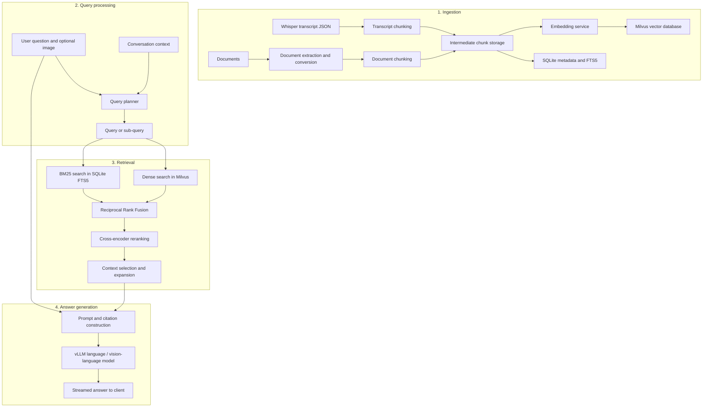

# Hybrid Multimodal RAG

A hybrid Retrieval-Augmented Generation (RAG) application combining dense vector retrieval, BM25 keyword search, rank fusion, reranking, and vision-language model (VLM) capabilities.

> Developed as a final-year group project at Calvin Institute of Technology.

[](https://www.python.org/)
[](https://fastapi.tiangolo.com/)
[](https://milvus.io/)
[](https://github.com/vllm-project/vllm)
[](./LICENSE)

---

## Table of Contents

- [Overview](#overview)
- [Features](#features)
- [System Architecture](#system-architecture)
- [Technology Stack](#technology-stack)
- [Project Structure](#project-structure)
- [Requirements](#requirements)
- [Installation](#installation)
- [Configuration](#configuration)
- [Running the Application](#running-the-application)
- [Using the Application](#using-the-application)
- [Evaluation](#evaluation)
- [Limitations](#limitations)
- [Potential Future Work](#potential-future-work)
- [Academic Information](#academic-information)
- [License and Third-Party Notices](#license-and-third-party-notices)

---

## Overview

**Hybrid Multimodal RAG** is a Retrieval-Augmented Generation application designed to answer questions using information retrieved from a knowledge base. It combines semantic vector search with keyword-based retrieval, then uses rank fusion and a reranking stage to select context for language-model generation.

The project is designed to work with heterogeneous information sources, including:

- **Documents:** PDF, DOCX, PPTX, XLSX, Markdown, HTML, text, CSV, JSON, XML, and RTF files, subject to the application's supported ingestion pipeline.
- **Video transcripts:** timestamped YouTube transcript data imported from Whisper-generated JSON.
- **Images:** image inputs supplied with chat prompts for vision-language question answering.

The application also provides knowledge-base management, user authentication, role-based access control, chat history, and administrative model-management functions.

### Why hybrid retrieval?

Dense retrieval can identify semantically related passages even when they do not share the exact query wording. Keyword retrieval can be useful for exact terms, names, identifiers, and technical vocabulary. This project combines both retrieval approaches:

1. Dense vector retrieval using Qwen3-VL-Embedding-2B and Milvus.
2. Sparse keyword retrieval using SQLite FTS5/BM25.
3. Reciprocal Rank Fusion (RRF) to combine ranked results.
4. Cross-encoder reranking to rescore retrieved candidates.
5. Adjacent-chunk expansion to provide surrounding context to the generator.

The relative performance of these approaches is evaluated in the project's benchmark materials. See [Evaluation](#evaluation).

## Features

The following summarizes the capabilities described in the project implementation and original project documentation. Confirm the current repository state before relying on any individual feature or command.

### 1. Document and transcript ingestion

- Document conversion and text extraction for supported file formats.
- Page-aware PDF processing intended to retain page information for citations.
- Extraction of embedded PDF images into document asset folders.
- Import of timestamped transcript data from Whisper-generated JSON.
- Chunking of documents and transcripts before embedding and indexing.
- Intermediate chunk data stored as JSON to separate preprocessing from indexing.

### 2. Hybrid retrieval and reranking

- **Dense retrieval:** Qwen3-VL-Embedding-2B embeddings indexed in Milvus.
- **Keyword retrieval:** SQLite FTS5 with BM25 ranking.
- **Rank fusion:** Reciprocal Rank Fusion (RRF).
- **Reranking:** Qwen3-VL-Reranker-2B served through vLLM.
- **Context expansion:** retrieval of adjacent chunks around selected results.
- **Relevance filtering:** score thresholds and relative-score filtering are described in the retrieval pipeline.

### 3. Query planning and answer generation

- LLM-assisted query planning and decomposition for complex questions.
- Use of conversation history when resolving follow-up questions.
- Context construction using retrieved passages.
- Streaming responses through the web application.
- Source references intended to identify documents, pages, and video timestamps.
- Image inputs in chat prompts for supported vision-language models.

### 4. Model and GPU management

- vLLM-based model serving through OpenAI-compatible endpoints.
- Separate services for generation, embeddings, and reranking.
- Administrative model switching between configured language models.
- Container orchestration intended to start model services in sequence and check service health.

### 5. Knowledge-base and user management

- Knowledge bases and hierarchical document folders.
- User authentication using JWT.
- Password hashing using bcrypt.
- Role-based access control, including knowledge-base access permissions.
- Chat sessions and conversation history.
- Persistent user-memory functionality, if enabled in the deployed configuration.
- API rate limiting on selected routes.

---

## System Architecture

The following diagram summarizes the intended application flow described in the project documentation. Actual service names and behavior should be checked against the current configuration and source code.



### Retrieval flow

1. The user submits a question, optionally with an image.
2. The query planner prepares the retrieval query or sub-queries.
3. Dense and sparse retrieval run against their respective indexes.
4. RRF combines the ranked candidate lists.
5. The reranker scores the candidates.
6. Selected chunks and, where applicable, adjacent chunks are assembled into context.
7. The generation model produces a response using the supplied context.

---

## Technology Stack

The table reflects the technologies named in the supplied project documentation. Versions and configuration should be confirmed against the current repository before release.

| Component | Technology / Model | Purpose |
|---|---|---|
| Backend | FastAPI | HTTP API and application backend |
| ASGI server | Uvicorn | Runs the FastAPI application |
| Relational storage | SQLite and SQLAlchemy | Users, documents, sessions, and metadata |
| Keyword search | SQLite FTS5 / BM25 | Sparse full-text retrieval |
| Vector database | Milvus Standalone | Vector storage and dense retrieval |
| Object storage / coordination | MinIO and etcd | Milvus supporting services |
| Model serving | vLLM | Model inference through HTTP endpoints |
| Embedding model | Qwen3-VL-Embedding-2B | Multimodal embeddings |
| Reranker | Qwen3-VL-Reranker-2B | Candidate relevance scoring |
| Default generation model | Qwen2.5-VL-7B-Instruct-NVFP4 | Vision-language generation |
| Alternative generation models | Phi-4-multimodal-instruct-NVFP4; Gemma-4-31B-IT-NVFP4 | Configured alternative generation models |
| Document processing | PyMuPDF and Microsoft MarkItDown | PDF extraction and document conversion |
| Tokenization | tiktoken | Conversation token-budget management |
| Authentication | python-jose and bcrypt | JWT handling and password hashing |
| Rate limiting | SlowAPI | Request rate limiting |
| Frontend | Jinja2, Tailwind CSS, and vanilla JavaScript | Web interface |
| Evaluation | DeepEval and Jupyter notebooks | Retrieval and generation experiments |

---

## Project Structure

The following is a condensed structure based on the supplied project documentation. Update it if the repository layout changes.

```text
hybrid-multimodal-rag/
├── app/
│   ├── api/                 # API routes
│   ├── core/                # Configuration and security utilities
│   ├── db/                  # Database models and session management
│   ├── ingest/              # Document and transcript ingestion
│   ├── models_manager/      # Model registry and inference clients
│   ├── rag/                 # Query planning, retrieval, reranking, generation
│   ├── services/            # Application business logic
│   ├── static/              # CSS and JavaScript assets
│   └── templates/           # Jinja2 HTML templates
├── templates/               # Model-serving prompt templates
├── tests/
│   ├── metrics/             # Evaluation notebooks and results
│   ├── milvus_db_test.ipynb
│   └── stream_test.ipynb
├── utils_old/               # Historical utilities and prototypes
├── config.json              # Application configuration
├── docker-compose.yml       # Supporting services and model containers
├── milvus.yaml              # Milvus configuration
├── model_orchestrator.py    # Container startup and health checks
├── requirements.txt         # Python dependencies
├── run.py                   # Application entry point
├── test_api.py              # API smoke tests
├── LICENSE
└── README.md
```

Runtime directories such as `data/`, `models/`, and local database files may be created or populated during use. Do not commit restricted datasets, model weights, credentials, or generated private data.

---

## Requirements

The original project documentation specifies the following environment:

- Linux (Ubuntu 22.04 or later recommended), or Windows 11 with WSL2.
- Python 3.12 or 3.13.
- Docker Engine 24.0 or later.
- Docker Compose v2.20 or later.
- NVIDIA GPU and compatible NVIDIA drivers.
- NVIDIA Container Toolkit for GPU access from containers.
- Sufficient GPU memory and disk space for the selected model configuration.

**Hardware note:** Actual GPU memory requirements depend on the models enabled, quantization, context length, batch size, and whether model services run concurrently. The larger configured models may require substantially more resources. Check the model documentation and your deployment configuration before choosing hardware.

---

## Installation

### 1. Clone the repository

Replace the URL with the actual public repository URL:

```bash
git clone https://github.com/dtann26/hybrid-multimodal-rag.git
```

### 2. Create a Python environment

```bash
python -m venv .venv
```

Activate it:

**Linux / macOS / WSL2**

```bash
source .venv/bin/activate
```

**Windows PowerShell**

```powershell
.venv\Scripts\Activate.ps1
```

Install the Python dependencies:

```bash
python -m pip install --upgrade pip
pip install -r requirements.txt
```

### 3. Obtain model weights

Model weights are **not included** in this repository. Obtain the required checkpoints from their official model repositories and comply with each checkpoint's license and terms.

The project documentation identifies these model repositories:

| Role | Model identifier |
|---|---|
| Default vision-language model | `nvidia/Qwen2.5-VL-7B-Instruct-NVFP4` |
| Embedding model | `Qwen/Qwen3-VL-Embedding-2B` |
| Reranker model | `Qwen/Qwen3-VL-Reranker-2B` |
| Alternative model | `nvidia/Phi-4-multimodal-instruct-NVFP4` |
| Alternative model | `nvidia/Gemma-4-31B-IT-NVFP4` |

Check the current model cards for access requirements, supported hardware, download instructions, and license terms. Place downloaded checkpoints where the model paths in your local configuration expect them. Do not commit model weights to Git.

---

## Configuration

### Environment variables

Create a local `.env` file for secrets and environment-specific settings. Do not commit `.env` to the repository. If the project provides an `.env.example`, use it as the template.

The supplied project documentation lists the following variables:

```ini
# Language model
LLM_MODEL_DIR_NAME=Qwen2.5-VL-7B-Instruct-NVFP4
MODEL_SERVED_NAME=Qwen2.5-VL-7B-Instruct-NVFP4
VLLM_PORT=8001
DTYPE=auto
MAX_MODEL_LEN=16384
TENSOR_PARALLEL_SIZE=1

# MinIO ports
MINIO_CONSOLE_HOST_PORT=12002
MINIO_HOST_PORT=12001

# Security
# Generate a unique secret for your deployment.
RAG_SECRET_KEY=replace-with-a-generated-secret-key

# Set a strong initial administrator password.
RAG_SUPERADMIN_PASSWORD=replace-with-a-strong-password
```

These names and defaults are taken from the supplied draft; verify that they match the current configuration loader and Docker Compose file. Never use the example values as production credentials.

### Application configuration

The project documentation identifies `config.json` as the central application configuration file. Settings described there include:

| Setting | Purpose |
|---|---|
| `app.host` / `app.port` | Web application host and port |
| `database.url` | SQLite database connection |
| `milvus.host` / `milvus.port` | Milvus connection |
| `rag.chunk_size` / `rag.chunk_overlap` | Text chunking parameters |
| `rag.top_k_retrieval` / `rag.top_k_rerank` | Retrieval and reranking candidate counts |
| `rag.reranker_threshold` | Reranker score threshold |
| `models.default_llm` | Default generation model |
| `models.embedding_api_endpoint` | Embedding service endpoint |
| `models.reranker_api_endpoint` | Reranking service endpoint |

Use the configuration file and environment variables that exist in your checked-out version of the project as the source of truth.

---

## Running the Application

### Start infrastructure and model services

The project includes run.py, a single startup script that automates the application startup process. It starts the required Docker containers and supporting model services, then launches the web application.

Run the following command from the project root directory:

```bash
python run.py
```

---

## Using the Application

The documented user workflow is:

1. **Sign in** using an account configured for the application.
2. **Select a knowledge base** to define the information collection used for retrieval.
3. **Optionally filter by source type**, where supported by the interface.
4. **Ask a question** in natural language.
5. **Attach an image** when using a configured vision-language workflow that supports image input.
6. **Review the answer and its references**, including document pages or transcript timestamps when available.

### Administration

The documented administration features include:

- Creating and managing knowledge bases.
- Organizing documents into folders.
- Uploading documents and triggering ingestion.
- Importing transcript data.
- Managing users and roles.
- Managing model configurations and model switching.

Administrative functions should only be exposed to appropriately authorized users.

---

## Evaluation

The project report evaluates retrieval, generation, and answer quality using an automatically generated question-answer dataset built from sampled knowledge-base documents and chunks. The report describes three evaluation stages: retrieval evaluation, generation evaluation, and DeepEval-based answer-quality evaluation.

### Retrieval evaluation

The report compares four retrieval strategies:

- **Dense Only:** vector-similarity retrieval.
- **Sparse (BM25):** lexical keyword retrieval.
- **Hybrid (Pure RRF):** combines dense and sparse rankings using Reciprocal Rank Fusion.
- **Hybrid + Rerank:** applies a cross-encoder reranker after hybrid retrieval.

The report uses Hit Rate@K and Mean Reciprocal Rank (MRR), as well as LLM-as-a-Judge semantic metrics: Hit@1, Hit@3, Hit@5, and NDCG@5.

**LLM-as-a-Judge semantic metrics (Based on figure 4.14 on the paper):**

| Retrieval strategy | Hit@1 | Hit@3 | Hit@5 | NDCG@5 |
|---|---:|---:|---:|---:|
| Dense Only | 0.67 | 0.85 | 0.89 | 0.79 |
| Sparse (BM25) | 0.52 | 0.74 | 0.84 | 0.67 |
| Hybrid (Pure RRF) | 0.67 | 0.85 | 0.87 | 0.76 |
| Hybrid + Rerank | 0.74 | 0.92 | 0.94 | 0.84 |

The report also states the following MRR@5 results:

| Retrieval strategy  | MRR@5 |
|---|---:|
| Dense Only | 0.764 |
| Sparse (BM25) | 0.637 |
| Hybrid (Pure RRF) | 0.758 |

The report identifies **Hybrid + Rerank as the best overall retrieval strategy**. It achieves the highest values across all four LLM-as-a-Judge semantic metrics shown above. The report does not state a numerical MRR@5 value for Hybrid + Rerank in the accompanying text, so one is not supplied here.

### Generation evaluation

The report compares three generation strategies for each language model:

1. **Base Knowledge:** the model answers without retrieval context.
2. **With Context:** retrieved context is provided directly to the model.
3. **Sliding Context:** retrieved context is expanded to include the chunks immediately before and after the main retrieved chunk.

Answers are evaluated against ground truth using an LLM-as-a-Judge approach.

### DeepEval results — Gemma

| Metric | Base Knowledge | With Context | Sliding Context |
|---|---:|---:|---:|
| Answer Relevancy | 0.84 | 0.86 | 0.88 |
| Faithfulness | - | 0.94 | 0.95 |
| Contextual Precision | - | 0.83 | 0.83 |
| Contextual Recall | - | 0.87 | 0.87 |
| Contextual Relevancy | - | 0.48 | 0.48 |
| Hallucination Metric | 0 | 0 | 0 |

The report states that Sliding Context achieves the highest Gemma Answer Relevancy score. Faithfulness is 0.00 for Base Knowledge because that strategy has no reference retrieval context; the With Context and Sliding Context scores are 0.94 and 0.95.

### DeepEval results — Qwen

| Metric | Base Knowledge | With Context | Sliding Context |
|---|---:|---:|---:|
| Answer Relevancy | 0.65 | 0.82 | 0.80 |
| Faithfulness | - | 0.91 | 0.89 |
| Contextual Precision | - | 0.82 | 0.82 |
| Contextual Recall | - | 0.86 | 0.86 |
| Contextual Relevancy | - | 0.46 | 0.48 |
| Hallucination Metric | 0 | 0 | 0 |

The report states that retrieval context improves Qwen Answer Relevancy from 0.65 (Base Knowledge) to 0.82 (With Context) and 0.80 (Sliding Context). Faithfulness is 0.91 and 0.89 for the two context-based strategies. Contextual Relevancy is reported in the range 0.46–0.48, with Sliding Context slightly higher than With Context.


### Evaluation artifacts

The project documentation identifies evaluation notebooks and result files under:

```text
tests/metrics/
```

Only publish evaluation artifacts if they do not contain restricted source data, derived restricted content, private metadata, or other material that you are not authorized to redistribute.

---

## Limitations

The following limitations are identified in the supplied project documentation. Confirm that they still apply to the current version:

- **Hardware requirements:** Running multiple inference services and larger models can require substantial GPU memory and disk space.
- **Model switching:** The documented deployment runs one primary generation model at a time; switching models may require stopping and starting containers.
- **Local relational storage:** SQLite is used for application metadata and chat-related storage. A multi-instance deployment may require a different database architecture.
- **Milvus deployment:** The documented setup uses a single Milvus deployment. Scaling and partitioning strategy may need further work for larger deployments.
- **Evaluation scope:** Reported benchmark results are based on specific datasets and configurations and may not generalize to other domains.

---

## Potential Future Work

Possible areas for future development include:

1. Adding a distributed task queue for long-running ingestion and processing jobs.
2. Evaluating PostgreSQL or another production database for multi-user and multi-instance deployments.
3. Adding an audio-native query interface.
4. Improving OCR, table extraction, and mathematical-content processing for complex documents.
5. Exploring multi-GPU model serving and request routing.
6. Expanding evaluation datasets and testing across more query types and document collections.

These are potential improvements, not claims about currently implemented functionality.

---

## Academic Information

This application was developed as a final-year group project at **Calvin Institute of Technology**.

- **Institution:** Calvin Institute of Technology
- **Program / Department:** IT & Big Data Analytics
- **Project type:** Final-year undergraduate group project
- **Academic year:** 2026

---

## License and Third-Party Notices

### Source code

The repository's original source code is intended to be distributed under the MIT License. See [`LICENSE`](./LICENSE) for the exact license text.

For a group project, confirm that the people or institution with the relevant rights have approved the selected license before publishing. The repository maintainer is not automatically the sole copyright holder.

The repository's source-code license does **not** automatically apply to third-party models, dependencies, external datasets, or materials owned by other parties.

### Third-party software

This project uses third-party software and frameworks. Their own license terms continue to apply. The supplied project documentation identifies, among others:

- FastAPI and Starlette
- SQLAlchemy
- Milvus and PyMilvus
- vLLM
- PyMuPDF
- Microsoft MarkItDown
- SlowAPI

Review the license distributed with each dependency and the applicable version. In particular, review PyMuPDF's licensing terms for your intended use.

### AI models

Model weights are not distributed in this repository. Users must obtain model checkpoints from their official sources and comply with the license and terms for the **specific checkpoint** they download.

Model names and checkpoint variants can have different licensing terms. Check each model card and license before use or redistribution. Do not assume that a quantized or repackaged checkpoint automatically has the same terms as its base model.

### Research data and source materials

Original research documents, YouTube transcripts, bulletins, video archives, and associated datasets used during development are not included in this repository.

These materials were used for research and development. This repository does not grant permission to redistribute, sublicense, or otherwise reuse those original materials. Users must provide their own data and ensure that they have the necessary rights and permissions.

Do not upload restricted source documents, transcript text, extracted chunks, embeddings derived from restricted materials, restricted metadata, or evaluation data that reproduces or reveals restricted source content.

---

## Acknowledgements

This project uses open-source software and externally developed AI models. We acknowledge the developers and maintainers of the libraries, frameworks, databases, and models used in the project. Please consult the relevant upstream projects and model cards for their individual licenses and attribution requirements.
